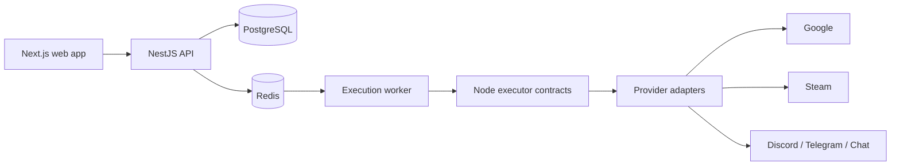

# Fluxora

Account settings are available from the avatar menu. Password recovery uses
separate, opt-in system SMTP configuration; see [account setup and activation](docs/29-account-recovery.md).

> A visual workflow automation platform for connecting everyday services, running dependable jobs, and inspecting every execution.

[](https://github.com/phuuthanh-dev/workflow-automation/actions/workflows/quality.yml)
[](./LICENSE)
[](https://nodejs.org/)
[](https://nextjs.org/)
[](https://nestjs.com/)

Fluxora is an open-source, self-host-ready workflow builder. It is designed as a polished personal and portfolio project first, while keeping the execution engine and connector boundaries ready for small teams later.

## Public website and workspace

- [Website](https://fluxora.io.vn/) · [Support](https://fluxora.io.vn/support) · [Privacy](https://fluxora.io.vn/privacy) · [Terms](https://fluxora.io.vn/terms)
- Local workspace: `/dashboard`, `/dashboard/connections`, `/dashboard/executions`; workflow editor: `/editor`.
- Connections can be searched by name/app. New secrets use labelled fields, with Edit JSON for advanced input; stored secrets stay encrypted.
- Public-page ownership and release evidence: [public website contract](docs/27-public-website.md). Shared UI behavior: [product experience](docs/28-product-experience.md).

## The demo in one minute

Build this workflow visually:

```text
Schedule → Steam account snapshot → Google Chat daily report
```

The editor lets you connect nodes, configure credentials, run a test, and inspect structured input/output without exposing secrets to the browser.

## What is included

| Area | Current capability |
| --- | --- |
| Workflow editor | Drag-and-drop graph, connections, auto-layout, node configuration, light/dark UI |
| Triggers | Manual, schedule, webhook |
| Logic | If/else and switch routing |
| Actions | Steam, Google Chat, Google Drive, Google Sheets, HTTP/API, GitHub |
| Notifications | Discord webhook, Telegram Bot API, Google Chat, SMTP email |
| Credentials | Encrypted server-side storage, OAuth 2.0 where supported, manual token/API key support |
| Authentication | Email/password, Google, GitHub, Steam identity linking |
| Execution | Mock/live modes, input/output inspection, retries, timeout and error paths |
| Operations | PostgreSQL persistence, Redis queue mode, worker process, Docker/VPS deployment |

Stored provider credentials are never returned to the browser and real provider calls are opt-in. Newly generated webhook signing/header secrets are shown once to the workspace owner for sender configuration. The repository test suite uses mock execution by default.

## Architecture at a glance



The repository is a small npm workspaces monorepo:

```text
apps/web                    Next.js dashboard and workflow editor
apps/api                    NestJS API, auth, scheduler, runner, and worker
packages/workflow-contracts Shared graph, node, and execution contracts
infra                       Docker Compose, Nginx, deployment scripts
docs                        Product spec, architecture, roadmap, and operations
```

The server owns workflow execution. Published workflow versions are immutable, and every execution points to the version it ran.

## Run locally

### Requirements

- Node.js 22+
- npm 10+
- PostgreSQL 16+
- Redis is optional for the default inline queue; use it for the production-shaped worker path

### Setup

```bash
git clone https://github.com/phuuthanh-dev/workflow-automation.git
cd workflow-automation
npm install

cp .env.example .env
# Set DATABASE_URL and the other local values in .env.

npm run db:deploy
npm run dev
```

Open:

- Web app: http://localhost:3000
- API health: http://localhost:3001/api/v1/health
- API readiness: http://localhost:3001/api/v1/health/ready

The root page is the public landing page; sign in at `/login` or create an account at `/register`. Registering creates a personal workspace and opens `/dashboard`. Local execution defaults to `EXECUTION_QUEUE_MODE=inline`, so the demo works without Redis or live provider credentials.

To run the Redis-backed worker path:

```bash
npm run dev:api
npm run dev:worker
npm run dev:web
```

If port `3001` is occupied:

```bash
PORT=3002 npm run dev:api
```

## Quality checks

Run the complete repository gate before opening a pull request:

```bash
npm run verify
```

The gate covers:

- a real Redis integration runtime (the configured Redis service in CI, or an isolated pinned Redis process for local API tests)
- API/worker handoff, bounded concurrency, delayed retry primitives, safe restart, persisted execution, and cross-process SSE invalidation

- code-graph freshness and deployment contract checks
- Prisma schema validation and client generation
- unit tests
- lint and TypeScript checks
- production builds
- Playwright browser tests

Useful focused commands:

```bash
npm run test:workspaces
npm run typecheck:workspaces
npm run build:apps
npm run test:e2e
npm run deployment:check
```

## Credentials and OAuth

Never commit `.env`, provider secrets, API keys, or encrypted production values. `.env` is ignored by Git and should stay local.

### Google connectors

Google Drive and Sheets use a manually supplied access token or Google OAuth connector credentials. Configure the connector callback from `.env.example` using `GOOGLE_REDIRECT_URI`.

Google Chat OAuth is a separate workspace connection. Enable the Chat API and
configure/verify its `chat.spaces.readonly` and `chat.messages.create` scopes
in the Google Cloud project before real use; these settings are not changed by
the application. Select a space and enter a message in the Chat OAuth node.
Manual tokens expire; the managed connection refreshes server-side. A delivery
without a confirmed response may already have arrived, so inspect the space
before retrying. Google Chat incoming webhooks remain a separate option.

### MongoDB

Create a MongoDB connection using separate fields or a connection string. The
fields accept a public DNS hostname, TLS-enabled port, database username/password
and authentication database. For connection strings, Fluxora supports a single
public hostname and `authSource`, `retryWrites`, `w`, `appName` and `tls` options;
TLS is required and automatic write retries remain disabled. Other options and
multiple hosts are rejected instead of silently ignored. With separate fields,
enter the hostname without `mongodb://` or `mongodb+srv://`. When an auto-detected host has no address record,
Fluxora tries its MongoDB SRV records and connects directly to a validated
writable seed; SRV supplies the port. It does not follow server-advertised
replica hosts, support automatic mid-operation failover, private network
addresses or custom TLS certificates. Select
a database and collection (or enter them manually), add simple filter conditions
or use advanced JSON, and set a limit from 1 to 100. Apply conditions before
running. Find and single-document Insert are supported;
update/delete are not. An insert with an uncertain response may have succeeded:
check the collection before retrying. Provider access is performed server-side
and requires a confirmed live run.

### Account sign-in

Account sign-in uses separate OAuth callbacks:

```text
Google account sign-in:
GOOGLE_AUTH_REDIRECT_URI

GitHub account sign-in:
GITHUB_AUTH_REDIRECT_URI
```

Set the corresponding client ID, client secret, and callback only on the API server. Never place these values in `NEXT_PUBLIC_*` variables.

### Steam

Steam account linking uses OpenID 2.0 to prove identity. It is separate from the Steam Account Snapshot node, which requires a Steam Web API key and a 64-bit Steam ID. Steam does not provide an OAuth access token for this flow.

For the production domain used by this project, the callbacks are:

```text
https://api.fluxora.io.vn/api/v1/auth/google/callback
https://api.fluxora.io.vn/api/v1/oauth/google/callback
https://api.fluxora.io.vn/api/v1/auth/github/callback
https://api.fluxora.io.vn/api/v1/auth/steam/callback
```

See [`docs/09-demo-walkthrough.md`](./docs/09-demo-walkthrough.md) for the safe demo flow and [`docs/15-deployment.md`](./docs/15-deployment.md) for production configuration.

## Deployment

The production-shaped deployment runs five services:

```text
Nginx + HTTPS
├── fluxora.io.vn       → web:3000
└── api.fluxora.io.vn   → api:3001

PostgreSQL + Redis + API worker
```

The repository includes Docker Compose and VPS deployment scripts. The recommended flow is:

1. Let the quality workflow pass on `main`.
2. Build and publish immutable application images to GHCR.
3. Deploy the image tag to the VPS.
4. Run migrations and health checks.
5. Keep a database backup before a production change.

Read the complete operator checklist in [`docs/15-deployment.md`](./docs/15-deployment.md). Do not copy a local `.env` wholesale to production; production database, domain, OAuth, and encryption settings must be reviewed separately.

## Documentation map

| Document | Purpose |
| --- | --- |
| [`AGENTS.md`](./AGENTS.md) | Rules for coding agents and contributors |
| [`docs/01-product-spec.md`](./docs/01-product-spec.md) | Product scope and acceptance criteria |
| [`docs/02-architecture.md`](./docs/02-architecture.md) | System boundaries and execution model |
| [`docs/04-roadmap.md`](./docs/04-roadmap.md) | Delivery phases |
| [`docs/06-loop-engineering.md`](./docs/06-loop-engineering.md) | Vertical-slice working loop |
| [`docs/10-agent-harness.md`](./docs/10-agent-harness.md) | Planner, implementer, CI, and review handoff |
| [`docs/11-code-graph.md`](./docs/11-code-graph.md) | Source dependency map |
| [`docs/13-ui-redesign-brief.md`](./docs/13-ui-redesign-brief.md) | UI/UX direction and design decisions |
| [`docs/15-deployment.md`](./docs/15-deployment.md) | Docker, VPS, Nginx, HTTPS, and rollback notes |

## Contributing

1. Read [`AGENTS.md`](./AGENTS.md) and the relevant docs.
2. Keep the change inside the current product scope.
3. Add tests for runner, credential, or connector behavior.
4. Regenerate the code graph after source-import changes.
5. Run `npm run verify` before opening a pull request.

## License

MIT. See [`LICENSE`](./LICENSE).
