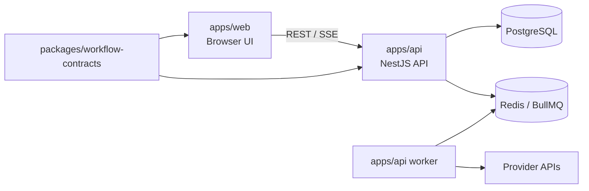

# Code Graph Guide

`docs/11-code-graph.json` is the generated, machine-readable map of internal TypeScript imports. Regenerate it after changing source imports:

```bash
npm run codegraph:generate
npm run codegraph:check
```

The graph deliberately excludes test files and third-party dependency internals. It is a navigation and review aid, not a substitute for architecture documentation.

## Boundary map



## Review traversal

| Change type | Start at | Trace before approving |
|---|---|---|
| Editor/UI | `apps/web/src/features` | API client contract, shared DTO, Playwright path |
| API route/auth | `apps/api/src/*/*.controller.ts` | guard, service, Prisma query, error/redaction behavior |
| Execution node | `apps/api/src/execution` | executor, credential boundary, retry/redaction, pinned version, tests |
| Provider credential | `apps/api/src/credentials` | encryption, API response serialization, node selector UX |
| Schema/migration | `apps/api/prisma` | service queries, migration, fixtures, rollback/retention impact |

## Protected boundaries

- `apps/web` must not import server credential/executor code or call providers directly.
- `packages/workflow-contracts` must stay framework-neutral.
- Workflow execution, credential decryption, outbound-request policy, and scheduler/worker lifecycle require a stronger review and targeted tests.
- An import crossing a boundary is a design event; update `docs/02-architecture.md` when it changes the system shape.
